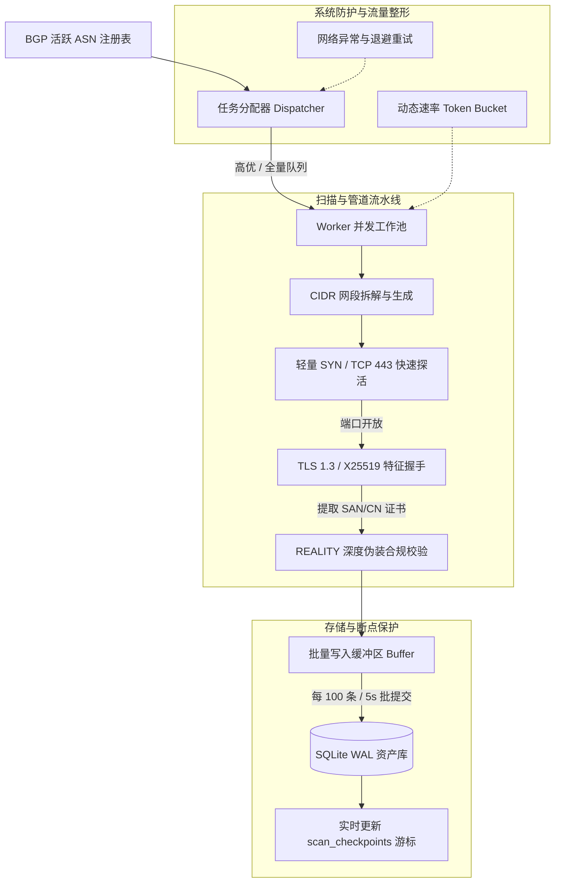

# 24小时全天候 ASN 全网扫描架构方案

## 一、 系统背景与战略目标

在 VLESS-REALITY 协议生态中，优质的偷跑目标（SNI / Target）是穿透审查与实现稳定低延迟网络传输的核心资产。过去依靠单次手动指定 IP 或特定 ASN 的扫描方式存在显著局限：
1. **人工干预多**：无法无人值守持续发现新目标；
2. **时效性不足**：互联网资产频繁更迭（证书过期、IP 变更、GFW 封锁），单次扫描的数据迅速老化；
3. **覆盖范围窄**：全球数以万计的自治系统（ASN）中蕴含大量低延迟、非机房特性的冷门优质域名未被挖掘。

本系统旨在建设**全天候 24 小时无人值守的全网 ASN 扫描与自动化沉淀引擎**，实现从全球活跃 ASN 调度、网段探测、REALITY 深度基线过滤到资产全生命周期保鲜的闭环。

---

## 二、 核心约束与 ASN 来源策略

### 1. 待扫描 ASN 的来源（为何严禁从 0 盲扫）

- **互联网现实拓扑**：
  - 16-bit ASN 范围为 `1 ~ 65535`，32-bit ASN 扩展至 `4294967295`（42 亿）。
  - 其中绝大多数号段属于 RFC 保留地址（如私有 ASN `64512-65534`、RFC 5398 文档测试号段、未分配号段等）。
  - 截至目前，**全球在 BGP 公网中实际宣告并活跃路由（Announced Active ASN）的自治系统总数仅约 75,000 ~ 85,000 个**。
  - **严重陷阱**：若从 0 纯数学递增扫至 42 亿，**超过 99.99% 的请求为空号段**。不仅会导致 99.9% 的 CPU 和网络带宽无效浪费，还会因高频请求空前缀直接触发 RIPE Stat / CAIDA 等权威机构的 API Rate Limit 封锁。

- **正确的全量 ASN 数据源方案**：
  1. **BGP 全局路由表转储（RIB Dump）**：每日定时从 [RouteViews](http://archive.routeviews.org/)、[RIPE RIS](https://www.ripe.net/analyse/internet-measurements/routing-information-service-ris/) 或 [CAIDA AS Rank](https://asrank.caida.org/) 下载最新全量活跃 ASN 清单（仅约 8 万条，离线包仅数兆字节）。
  2. **MaxMind GeoLite2-ASN 离线库**：直接从本地 `GeoLite2-ASN.mmdb` 中逆向提取所有分配了 CIDR 前缀的非空 ASN 集合。
  3. **IANA 官方已分配 ASN 注册表同步**。

### 2. 调度策略：双队列分层优先级（Priority Queue）

单纯按 ASN 数字从低到高升序扫描，存在明显的“冷热不均”与产出滞后问题：
- `AS1` ~ `AS500` 大多分配于 20 世纪 80~90 年代，多为科研机构、老牌电信骨干（如 AS1 Level3、AS4 DoD），现代商业业务与高质量 SNI 极其稀少；
- 主流公有云与优质 CDN/IDC（如 Cloudflare `AS13335`、Oracle `AS31898`、DigitalOcean `AS14061`、AWS `AS16509`）往往分布在长尾号段中。

**调度策略制定**：
```text
┌─────────────────────────────────────────────────────────────┐
│                    全局 ASN 调度中枢 (Master)                │
└──────────────┬──────────────────────────────┬───────────────┘
               │ (70% 资源配比)               │ (30% 资源配比)
               ▼                              ▼
     【队列 A：高优热门池】          【队列 B：全网巡检池】
     - 全球 Top 1000 活跃机房/云商  - 全球 80,000+ 活跃有效 ASN
     - 重点产出、高频率保鲜         - 按 ASN 编号从小到大无休推进
     - 周期：每 7 ~ 14 天重扫       - 周期：数周持续覆盖全网长尾
```

---

## 三、 24小时系统架构与工作流水线



### 1. 两级探针机制（解决 /16 大网段耗时痛点）
- 对于拥有数十万 IP 的大网段（如 `/16` 包含 65,536 个 IP），若直接进行耗时较长的 TLS 全握手及 HTTP HEAD 探测，整体吞吐量会急剧下降；
- **Stage 1 (预探)**：使用非阻塞 TCP Connect / SYN Ping 探查 443 端口开放情况；
- **Stage 2 (深度审计)**：仅对 443 开放的存活 IP 执行完整的 TLS 1.3 + H2 + X25519 握手与证书解析。

### 2. 状态断点与秒级恢复（Fault Tolerance）
- 依托现有 `scan_checkpoints` 机制，扫描器以 `task_key = "ASN_{asn}_{cidr}"` 为粒度；
- 每处理 500 个 IP 或每隔 30 秒自动记录当前 CIDR 的最新扫描游标 `last_ip`；
- 遭遇系统重启、网络故障断开时，重启守护进程即可秒级衔接断点继续推进，无重复扫描浪费。

### 3. 流量整形与防封策略（Traffic Shaping & Rate Limiting）
- **令牌桶（Token Bucket）**：限制单机向目标 ASN 的总并发 PPS（Packets Per Second）与并发 TCP 握手数；
- **端口快速回收**：TCP 连接关闭时一律启用 `SetLinger(0)`，配合 `TIME_WAIT` 快速释放，防止宿主机 Ephemeral Ports 端口耗尽。

---

## 四、 研发计划与交付里程碑

| 阶段 | 目标 | 核心任务清单 | 交付物与形态 |
| :--- | :--- | :--- | :--- |
| **Phase 1**<br>数据源与元数据底座 | 建立全球 ASN 任务底座 | 1. 编写离线脚本与更新源，同步全网活跃 ASN 列表；<br>2. 注入 Top 1000 热门云厂商/IDC 权重表；<br>3. 升级 `store.go` 数据库表结构，引入 `asn_registry`。 | `internal/asn/registry.go`<br>全网 ASN 元数据初始化 |
| **Phase 2**<br>全天候守护与调度引擎 | 实现 24h 自动轮巡与断点续扫 | 1. 研发 `DaemonScheduler`，调度 Pending -> Running -> Completed 状态；<br>2. 实现双队列调度算法（热门优先 + 升序长尾兜底）；<br>3. 增加 CLI 子命令 `reality-checker daemon` 与平滑退出。 | `internal/core/daemon.go`<br>`reality-checker daemon` |
| **Phase 3**<br>双轨巡检与资产保鲜 | 解决数据老化与淘汰问题 | 1. 研发轻量巡检 Worker（Watchdog），周期复测存量目标；<br>2. 连续失败降级与失效归档（连续 3 次探测失败标记下架）；<br>3. 数据库定期 WAL 检查点整理与碎片清理。 | `internal/core/patrol.go`<br>存量资产健康巡检 |
| **Phase 4**<br>性能加速与大盘监控 | 吞吐翻倍与可视化运维 | 1. 引入两级 TCP/SYN 预探机制，降低 80% 无效握手；<br>2. 提供轻量 Web Dashboard 或 CLI 实时进度（展示扫描速率、命中率）；<br>3. 提供 RESTful API 供下游订阅面板一键调用。 | Web 状态大盘 / API 服务 |
