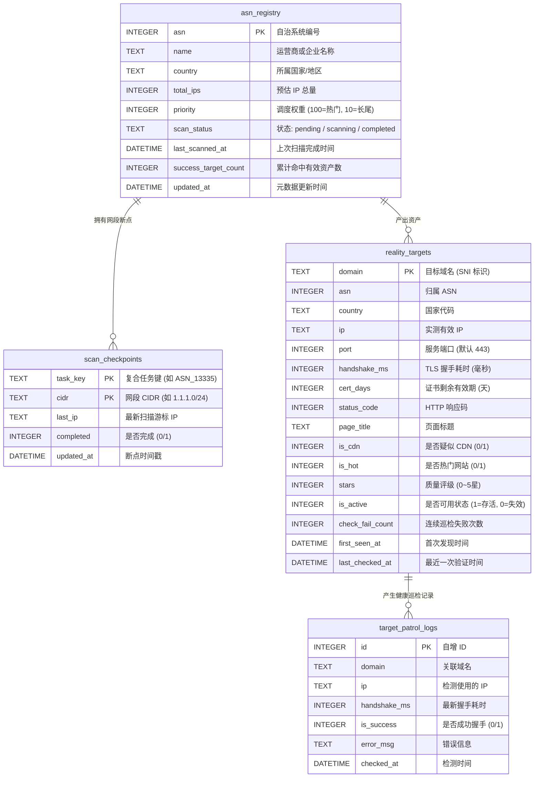

# 数据库设计与资产生命周期管理

## 一、 数据库选型与演进路线

针对 24 小时全网不间断扫描系统，预计在数月内将沉淀十万至数百万级全网 REALITY 目标资产。系统采用分层演进的存储方案：

1. **单机嵌入式存储（当前阶段 - SQLite WAL 模式）**：
   - 零依赖、单二进制部署，开箱即用；
   - 开启预写日志模式（`PRAGMA journal_mode=WAL`）与单写多读并发；
   - 内存缓冲区（Buffer Queue）聚合批量事务提交（100 条 / 5 秒），消除磁盘 I/O 成为性能瓶颈；
   - 适用规模：单机 100 万条以内数据高效运转。
2. **企业级/分布式集群演进（未来扩展 - PostgreSQL）**：
   - 抽象通用存储接口 `TargetStoreInterface`；
   - 支持多扫描探针（Multi-node Probes）分布式上报至集中式 PostgreSQL 库。

---

## 二、 完整数据库 Schema 设计



### DDL 建表脚本（SQLite 方言）

```sql
-- 1. 全球 ASN 任务管理表
CREATE TABLE IF NOT EXISTS asn_registry (
    asn INTEGER PRIMARY KEY,
    name TEXT NOT NULL DEFAULT '',
    country TEXT NOT NULL DEFAULT '',
    total_ips INTEGER NOT NULL DEFAULT 0,
    priority INTEGER NOT NULL DEFAULT 10,
    scan_status TEXT NOT NULL DEFAULT 'pending',
    last_scanned_at DATETIME,
    success_target_count INTEGER NOT NULL DEFAULT 0,
    updated_at DATETIME NOT NULL
);
CREATE INDEX IF NOT EXISTS idx_asn_priority_status ON asn_registry (priority DESC, scan_status);
CREATE INDEX IF NOT EXISTS idx_asn_country ON asn_registry (country);

-- 2. 网段扫描断点进度表
CREATE TABLE IF NOT EXISTS scan_checkpoints (
    task_key TEXT NOT NULL,
    cidr TEXT NOT NULL,
    last_ip TEXT NOT NULL DEFAULT '',
    completed INTEGER NOT NULL DEFAULT 0,
    updated_at DATETIME NOT NULL,
    PRIMARY KEY (task_key, cidr)
);
CREATE INDEX IF NOT EXISTS idx_checkpoints_task ON scan_checkpoints (task_key);

-- 3. REALITY 优质资产主表
CREATE TABLE IF NOT EXISTS reality_targets (
    domain TEXT PRIMARY KEY,
    asn INTEGER NOT NULL,
    country TEXT NOT NULL,
    ip TEXT NOT NULL,
    port INTEGER NOT NULL DEFAULT 443,
    handshake_ms INTEGER NOT NULL,
    cert_days INTEGER NOT NULL,
    status_code INTEGER NOT NULL DEFAULT 0,
    page_title TEXT,
    is_cdn INTEGER NOT NULL DEFAULT 0,
    is_hot INTEGER NOT NULL DEFAULT 0,
    is_default_page INTEGER NOT NULL DEFAULT 0,
    default_page_type TEXT,
    stars INTEGER NOT NULL DEFAULT 0,
    is_active INTEGER NOT NULL DEFAULT 1,
    check_fail_count INTEGER NOT NULL DEFAULT 0,
    first_seen_at DATETIME NOT NULL,
    last_checked_at DATETIME NOT NULL
);
CREATE INDEX IF NOT EXISTS idx_targets_asn ON reality_targets (asn);
CREATE INDEX IF NOT EXISTS idx_targets_country ON reality_targets (country);
CREATE INDEX IF NOT EXISTS idx_targets_stars_active ON reality_targets (stars DESC, is_active);
CREATE INDEX IF NOT EXISTS idx_targets_last_checked ON reality_targets (last_checked_at);

-- 4. 存量资产健康巡检日志表（支持滑动窗口归档）
CREATE TABLE IF NOT EXISTS target_patrol_logs (
    id INTEGER PRIMARY KEY AUTOINCREMENT,
    domain TEXT NOT NULL,
    ip TEXT NOT NULL,
    handshake_ms INTEGER NOT NULL,
    is_success INTEGER NOT NULL,
    error_msg TEXT,
    checked_at DATETIME NOT NULL
);
CREATE INDEX IF NOT EXISTS idx_patrol_domain_checked ON target_patrol_logs (domain, checked_at);
```

---

## 三、 资产生命周期与后期保鲜更新机制

单纯盲扫入库会导致数据迅速“僵尸化”（例如目标网站更新证书切换为自签、IP 转移、域名解析变动）。系统设计了**双轨并行（Dual-Track）更新模型**：

```text
┌─────────────────────────────────────────────────────────────┐
│                      资产状态机流转图                       │
└─────────────────────────────────────────────────────────────┘

    [新扫描发现] ───> 【Active (5星/4星)】
                            │
              ┌─────────────┴─────────────┐
              │ 巡检成功                  │ 巡检失败 1 次
              ▼                           ▼
      【更新延迟/证书】              【降星 (扣 1 星)】
      `last_checked_at`刷新              │
                                         │ 连续失败 3 次
                                         ▼
                                  【Inactive 标记下架】
                                  `is_active = 0`
                                         │
                                         │ 失效满 30 天未复活
                                         ▼
                                  【数据归档 / 物理删除】
```

### 1. 分级巡检策略（Watchdog 周期）
- **高价值资产（4~5星）**：每 **24 小时** 复测一次，优先保证高质量目标时刻在线；
- **普通资产（2~3星）**：每 **72 小时** 复测一次；
- **巡检流程**：仅执行快速 TLS 握手，耗时在毫秒级别，开销极小。

### 2. 状态更新算法
- **握手成功**：
  - 重置 `check_fail_count = 0`；
  - 标记 `is_active = 1`；
  - 重新采样并加权平滑记录 `handshake_ms`；
  - 计算证书剩余有效天数 `cert_days`；
  - 更新 `last_checked_at = time.Now()`。
- **握手失败**：
  - 递增 `check_fail_count++`；
  - 若 `check_fail_count >= 3`，设置 `is_active = 0`（节点从导出/可用列表隐藏，保留观察）；
  - 若连续失效达 30 天且多次复查均超时，转入归档表或删除。

### 3. SQLite 数据库维护与性能保障
- **WAL 检查点（Checkpointing）**：每天低峰期自动执行 `PRAGMA wal_checkpoint(TRUNCATE)`，避免 WAL 文件无节制膨胀；
- **日志裁剪**：`target_patrol_logs` 仅保留最近 7 天的巡检轨迹，超期记录自动清理。
